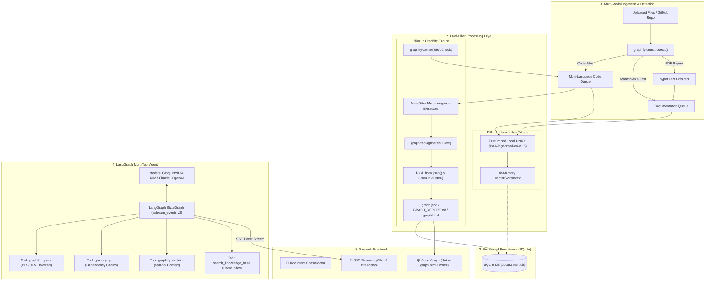

# ⚡ DocuStream Pro — Dual-Pillar Codebase & Document Intelligence Platform


**DocuStream** is a modern, production-grade **Codebase Intelligence & Document Consolidation Platform**. It seamlessly bridges multi-modal document processing with state-of-the-art **Dual-Pillar GraphRAG**:
1. **Structural Code Graph (Graphify)**: Multi-language Tree-Sitter AST parsing, Louvain community clustering, central God Node detection, and interactive graph exploration.
2. **Semantic Knowledge Base (LlamaIndex + FastEmbed)**: 100% local, zero-token cost vector embeddings over Markdown documentation, specifications, and extracted PDF pages.
3. **Agentic Reasoning (LangGraph)**: Multi-provider reasoning agent (Groq, NVIDIA NIM, Anthropic Claude, OpenAI) streaming live reasoning steps and tokens via Server-Sent Events (SSE).
4. **Document Consolidation**: Fast multi-file merging and export to clean Markdown (`.md` with Table of Contents), Plain Text (`.txt`), and pure-Python PDF (`.pdf` via ReportLab & PyPDF).

---

## 🏛️ Dual-Pillar Architecture



---

## 🚀 Key Features

### 1. 🕸️ Pillar 1: Graphify Code Knowledge Graph
- **Multi-Language AST Extraction**: Powered by official Graphify Tree-Sitter extractors for Python, JavaScript, TypeScript, Go, Rust, C#, Java, and more.
- **Topological Analysis**:
  - **Louvain Community Clustering**: Automatically segments codebases into functional, cohesive modules.
  - **God Node Identification**: Detects architectural bottlenecks and high-centrality modules.
  - **Surprising Connections**: Flags hidden cross-module couplings and architectural anti-patterns.
- **GraphRAG Traversal**:
  - `graphify_query`: BFS and DFS topological traversals with strict token budgeting.
  - `graphify_path`: Computes the shortest call-chain or inheritance path between symbols.
  - `graphify_explain`: In-depth caller, callee, and community context for any symbol.
- **Official Interactive Visualizer**: Embeds Graphify's high-performance `graph.html` visualizer directly inside Streamlit with community color coding, physics simulation, and auto-aggregation for large graphs.

### 2. 📄 Pillar 2: LlamaIndex Semantic Vector Index
- **100% Local & Free Embeddings**: Uses `llama-index-embeddings-fastembed` (`BAAI/bge-small-en-v1.5`) running locally on CPU via ONNX Runtime. Consumes zero API tokens and runs completely offline.
- **Multi-Modal Text Ingestion**: Seamlessly indexes Markdown files, technical specifications, docstrings, and multi-page PDF documents.
- **Granular Retrieval**: Filtered semantic search matching natural language questions to exact source passages and PDF page numbers.

### 3. 🤖 Agentic Reasoning & Live SSE Streaming
- **LangGraph StateGraph**: Orchestrates multi-step reasoning, determining dynamically whether to traverse the code graph, search documentation vectors, or fuse both.
- **Live Event Streaming (SSE)**: Uses LangGraph v2 `astream_events` to stream thinking steps, tool call badges (`*⚡ Traversing code graph...*`), and generated tokens in real time.
- **Multi-Provider Support**:
  - **Groq Cloud**: High-throughput inference with Llama 3.3 70B, Mixtral 8x7B, and DeepSeek-R1.
  - **NVIDIA NIM**: Enterprise-grade inference via `build.nvidia.com` (Nemotron 3.5, Llama 3.1 70B).
  - **Anthropic**: Claude 3.7 Sonnet, Claude 3.5 Sonnet, Claude 3.5 Haiku.
  - **OpenAI**: GPT-4o, GPT-4o-mini, o3-mini.

### 4. 💾 Embedded SQLite Storage Layer
- **Multi-Worker Concurrency**: Eliminates in-memory dictionary process isolation when running Uvicorn with `--workers > 1`.
- **Low RAM Footprint**: Serializes `graph.json`, `GRAPH_REPORT.md`, and session states into `data/docustream.db`, loading into NetworkX on demand.
- **SHA-256 Manifest Tracking**: Built-in caching ensures subsequent file uploads or Git pulls only re-extract changed files.

### 5. 📄 Document Consolidator & Queue Manager
- **Pure-Python Multi-Format Consolidation**:
  - **Markdown (`.md`)**: Generates consolidated Markdown with an automated Table of Contents (TOC) linking directly to syntax-highlighted code fences (`python`, `javascript`, `typescript`, `go`, `rust`, etc.).
  - **Plain Text (`.txt`)**: Clean text output with distinct file separator banners.
  - **PDF Documents (`.pdf`)**: Generates styled PDFs via **ReportLab** with two-pass header/footer pagination (`NumberedCanvas`), or appends existing PDF files directly via **pypdf** with zero external binaries (100% pure Python — no LibreOffice or Word required).
- **Queue Management & Organization**:
  - **Multi-File Upload**: Drag-and-drop uploader with state-cycling resets to prevent widget desync.
  - **Search & Filtering**: Live filter bar to search queue by filename or extension.
  - **Interactive Reordering**: Drag-and-drop sequence reordering powered by `streamlit-sortables`.
  - **GitHub Tree Ingestion**: Tree view explorer for public and private repositories with branch selection and pattern exclusion.
  - **Persistent Previews**: Instant text and markdown previews with download state persistence across reruns.

---

## 🏗️ Project Structure

```
DocuStream/
├── api/                            # FastAPI Backend Service
│   ├── main.py                     # API entrypoint, routes, & SSE stream
│   ├── graphify_engine.py          # Graphify AST extraction & traversal
│   ├── llamaindex_engine.py        # LlamaIndex FastEmbed local vector search
│   ├── hybrid_retriever.py         # Graph + Vector fusion layer
│   ├── agent.py                    # LangGraph multi-tool reasoning agent
│   └── models.py                   # Pydantic schemas
├── core/                           # Core Platform Services
│   ├── storage.py                  # SQLite session & artifact database
│   ├── consolidator.py             # File merger, sanitization, & token counter
│   └── github_service.py           # GitHub API tree & blob loader
├── frontend/                       # Streamlit UI
│   ├── app.py                      # Multi-tab Streamlit dashboard
│   ├── components/                 # UI components
│   │   ├── consolidator_ui.py      # Merger & file queue panel
│   │   ├── graph_view.py           # Graphify graph.html interactive view
│   │   ├── chat.py                 # Real-time SSE streaming chat
│   │   ├── file_manager.py         # File upload & management
│   │   └── github_loader.py        # GitHub repository explorer
│   └── styles/                     # Modern glassmorphism CSS
├── report/                         # Architectural Reports & Plans
│   ├── DUAL_ARCHITECTURE_PLAN.md   # Complete Graphify + LlamaIndex plan
│   ├── FUTURE_PLANS.md             # Long-term roadmap
│   └── VERIFICATION_REPORT.md      # Test verification reports
├── requirements.txt                # Python dependencies
├── Dockerfile                      # Container specification
├── docker-compose.yml              # Multi-container orchestration
└── app.py                          # Root entrypoint
```

---

## 📋 Prerequisites

- **Python**: 3.11 or higher (Zero external C++/Java binaries required; all document processing, AST parsing, and embeddings run in pure Python / ONNX).

---

## 🔧 Installation & Setup

### 1. Clone the Repository
```bash
git clone https://github.com/Noob-Coder2/DocuMerger.git
cd DocuMerger
```

### 2. Set Up Virtual Environment & Dependencies
```bash
python -m venv .venv
# On Windows:
.venv\Scripts\activate
# On Linux/macOS:
source .venv/bin/activate

pip install -r requirements.txt
```

### 3. Configure Environment Variables
Create a `.env` file in the root directory:
```env
# Optional Provider Keys (or configure directly in the UI)
NVIDIA_API_KEY=nvapi-...
GROQ_API_KEY=gsk_...
ANTHROPIC_API_KEY=sk-ant-...
OPENAI_API_KEY=sk-...

# Optional GitHub Token for private repos and higher rate limits
GITHUB_TOKEN=ghp_...
```

---

## 🚀 Running DocuStream

### Option A: Local Development (Separate Services)

1. **Start the FastAPI Backend** (Port 8000):
   ```bash
   uvicorn api.main:app --host 0.0.0.0 --port 8000 --reload
   ```

2. **Start the Streamlit Frontend** (Port 8501):
   ```bash
   streamlit run app.py
   ```
   Open your browser at `http://localhost:8501`.

### Option B: Docker Compose

```bash
docker-compose up -d
```
Access the application at `http://localhost:8501`.

---

## 🧪 Testing

Execute the comprehensive test suite:

```bash
pytest tests/ -v
```

Tests cover:
- **Storage**: SQLite database initialization, serialization, and manifest tracking.
- **Graphify**: Multi-language AST parsing, diagnostics health check, community clustering, and HTML export.
- **LlamaIndex**: FastEmbed ONNX local embedding and semantic document retrieval.
- **LangGraph**: Multi-tool agent execution and SSE streaming.
- **FastAPI**: Ingestion endpoints and live SSE streaming response.

---

## 🔒 Security & Privacy

- **100% Local Ingestion**: Code AST parsing (Graphify) and vector embeddings (FastEmbed) run entirely on your local machine. No codebase data is transmitted to third parties during ingestion.
- **Secret Sanitization**: Automatic redaction of OpenAI, AWS, and Google API keys prevents accidental leaks in merged files or prompt contexts.
- **Path Traversal Protection**: Secure filename validation blocks directory traversal attacks.

---

## 📝 License

This project is licensed under the MIT License — see the [LICENSE](LICENSE) file for details.